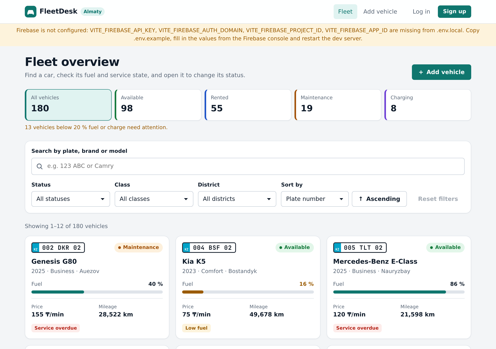
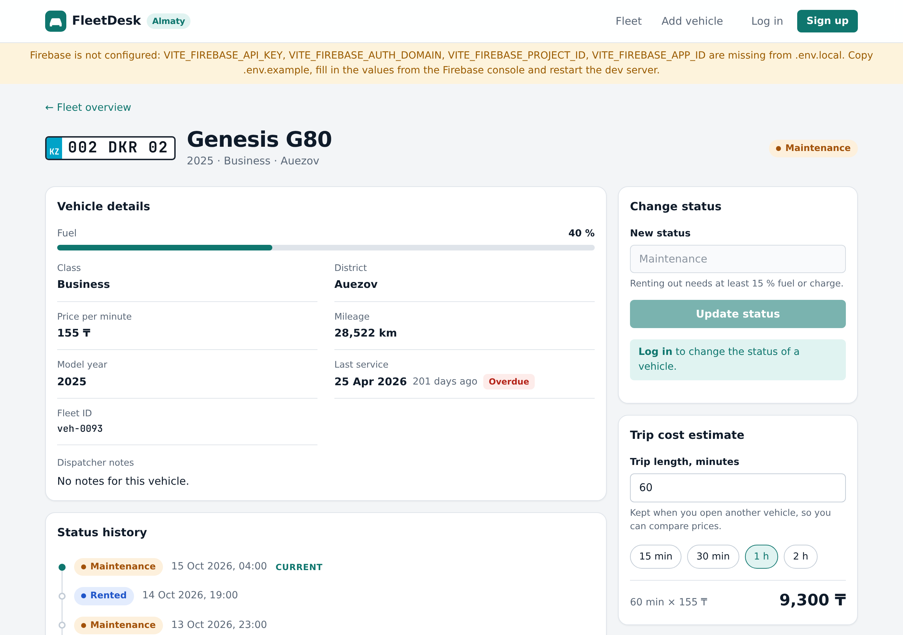
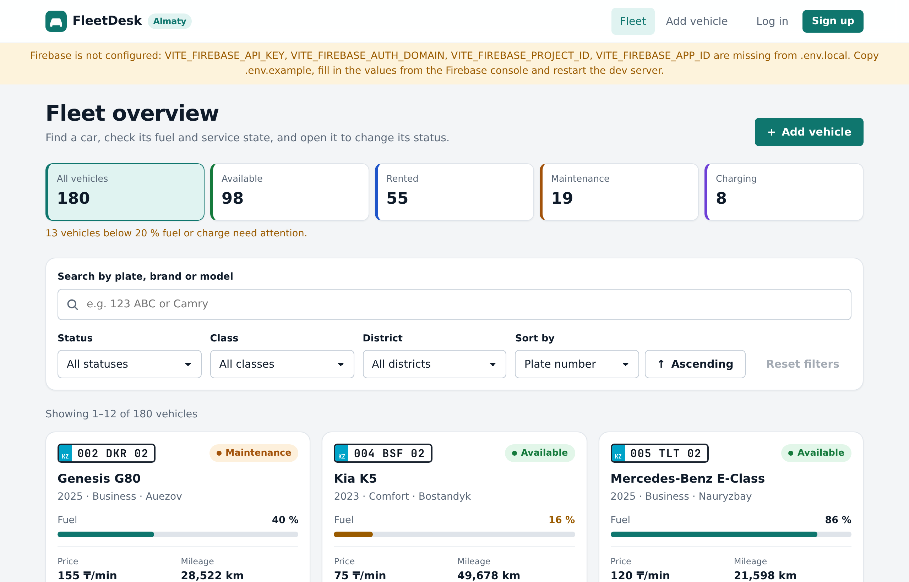
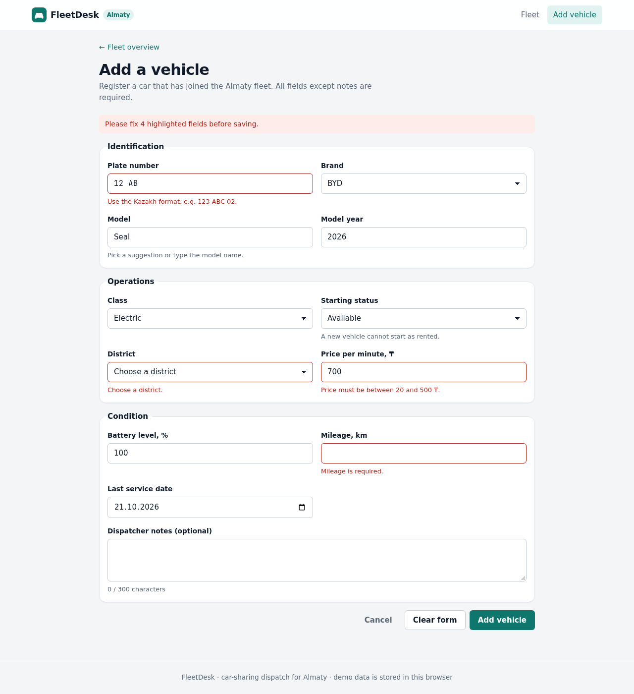
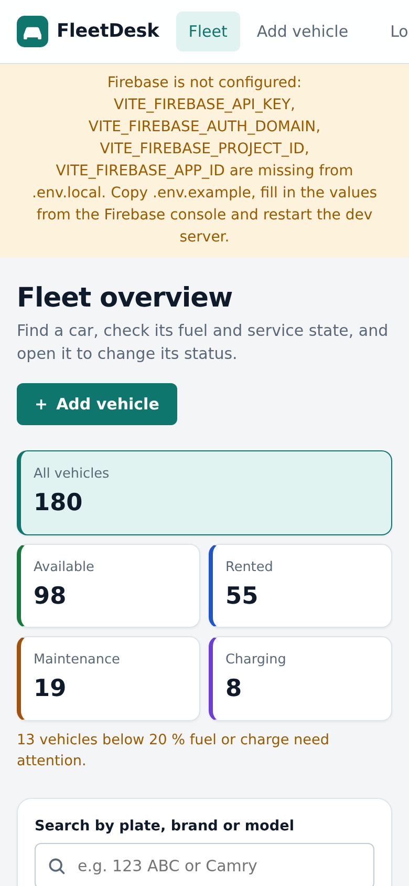
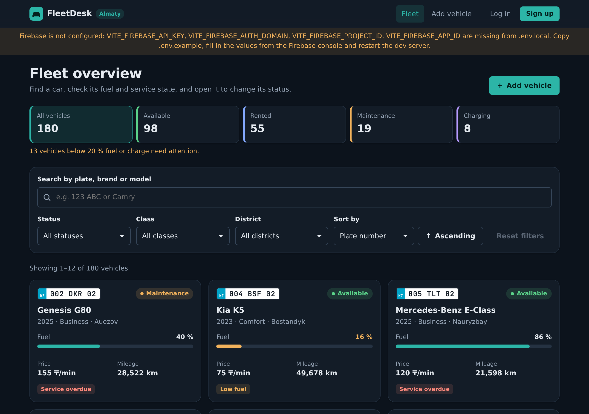

# FleetDesk — car-sharing dispatch for Almaty

FleetDesk is a React single-page application for a dispatcher who runs a car-sharing fleet in Almaty.
The dispatcher can find any of the 180 cars, see which ones are low on fuel or overdue for service,
open a car to change its status (available / rented / maintenance / charging), estimate the cost of a
trip, find an available replacement nearby, register new cars and retire old ones.

Fleet data comes from a **simulated REST-like API** in `src/api/`: it answers with Promises after a
realistic network delay, supports request cancellation and stores the fleet in `localStorage`.
Every answer is **cached by TanStack Query**, and **Firebase Authentication** (email/password and
Google) decides who may change the fleet.

> Homework 6 for the React course (KBTU): server data, caching and Firebase authentication.
> Built on top of the midterm project — all of its routes, filters, pagination and functionality are kept.
> Requirement checklists: [`docs/HOMEWORK6.md`](docs/HOMEWORK6.md) · [`docs/REQUIREMENTS.md`](docs/REQUIREMENTS.md).
> Architecture decisions: [`docs/DECISIONS.md`](docs/DECISIONS.md).

## Screens and features

| Fleet overview | Vehicle details |
| --- | --- |
|  |  |

| Log in | Sign up |
| --- | --- |
|  |  |

| Add a vehicle (validation) | Mobile (390 px) | Dark theme |
| --- | --- | --- |
|  |  |  |

**Fleet overview** (`#/`) — public
- Summary tiles with the number of cars per status; a tile also works as a one-click status filter.
- Search by plate, brand or model (debounced, 400 ms). Plates match with or without spaces: `123abc` finds `123 ABC 02`.
- Filters by **status**, **class** and **district**; sorting by plate, price per minute, fuel/charge, mileage, model year or last service date, ascending or descending.
- Pagination with 12 / 24 / 48 cars per page. Changing the search, a filter or the sort order returns to page 1.
- Search, filters, sort and page are kept for the browser tab, so coming back from a car's page restores the same view.
- Loading, error (with **Retry**), empty (with **Reset filters**) and success states. While a new page loads, the previous results stay visible but dimmed.
- Every combination of filters the dispatcher has already opened comes back from the cache instantly.

**Vehicle details** (`#/vehicles/:id`) — public, actions need a login
- All vehicle fields, days since the last service with an "Overdue" flag after 180 days, dispatcher notes.
- **Change status**: validated by the API (charging is only for electric cars; renting needs at least 15 % fuel/charge). The status history timeline updates immediately.
- **Remove from fleet**: two-click confirmation; a rented car has to come back first.
- **Trip cost estimate**: enter minutes or use a preset. The value is kept when you open another car, so prices can be compared.
- **Available cars of the same class in the same district**: replacement candidates, sorted by fuel level.
- Separate "Vehicle not found" state for unknown ids.

**Add a vehicle** (`#/vehicles/new`) — protected
- Fully controlled form with 12 fields grouped into sections.
- Validation messages appear next to fields after the field is left or on submit. Cross-field rules: a non-electric car cannot start as "charging" (the status falls back automatically), the service date cannot be in the future or before the model year.
- The API validates again and rejects duplicate plates; server errors are shown next to the relevant field and the entered data is kept.
- The submit button is locked while saving; on success the app opens the new car's page.

**Log in / Sign up** (`#/login`, `#/signup`) — public
- Email + password, or **Continue with Google** (popup).
- Sign-up asks for the password twice and checks the address, the length and that both copies match before Firebase is called.
- Firebase error codes are translated into readable sentences and shown next to the field they belong to.
- After a login the user lands on the page they originally wanted, not on a generic home page.

**Profile** (`#/profile`) — protected
- Email (with verification state), UID, sign-in method, account creation and last sign-in time, and a **Log out** button.

**Accessibility**: semantic landmarks, a `<label>` for every control, visible focus rings, `aria-live` regions for loading/results/errors, `aria-pressed` on toggle tiles and chips, `aria-current` on the current page, and `prefers-reduced-motion` support.

## Tech stack

- [React 18](https://react.dev/) (JavaScript + JSX), hooks only
- [React Router 7](https://reactrouter.com/) with a hash router (`createHashRouter`)
- [TanStack Query 5](https://tanstack.com/query/latest) for server-data caching, revalidation and invalidation
- [Firebase Authentication 13](https://firebase.google.com/docs/auth) — email/password and Google sign-in
- [Vite 8](https://vite.dev/) for the dev server, environment variables and the production build
- Plain CSS with custom properties (light and dark theme, mobile-first)
- ESLint 9 with `eslint-plugin-react`, `eslint-plugin-react-hooks` and custom rules that forbid direct DOM access and index keys

No UI kits and no state-management library: the only global state is the authenticated user (React context) and the query cache.

## Getting started

Requirements: Node.js 20 or newer.

```bash
npm install
cp .env.example .env.local   # then fill in the Firebase values, see below
npm run dev                  # http://localhost:5173
```

The app runs without Firebase keys too: the fleet, filters and caching all work, a banner explains
which variables are missing, and only the sign-in screens are disabled.

| Script | What it does |
| --- | --- |
| `npm run dev` | Start the dev server with hot reload |
| `npm run build` | Build the production bundle into `dist/` |
| `npm run preview` | Serve the production build locally (http://localhost:4173) |
| `npm run lint` | Run ESLint; fails on any error or warning |

### Environment variables

All configuration lives in `.env.local`, which is **git-ignored**; `.env.example` is the template
that is committed. Vite exposes to the browser only variables whose name starts with `VITE_`, and it
reads the file **once at startup** — restart the dev server after changing it.

| Variable | Where to find it |
| --- | --- |
| `VITE_FIREBASE_API_KEY` | Firebase console → Project settings → General → Your apps → SDK setup and configuration |
| `VITE_FIREBASE_AUTH_DOMAIN` | same screen (`<project-id>.firebaseapp.com`) |
| `VITE_FIREBASE_PROJECT_ID` | same screen |
| `VITE_FIREBASE_STORAGE_BUCKET` | same screen |
| `VITE_FIREBASE_MESSAGING_SENDER_ID` | same screen |
| `VITE_FIREBASE_APP_ID` | same screen |

They are read in exactly one place, `src/firebase.js`, which also reports which of them are missing.
These values are public by design — they identify the project, they do not grant access; access is
controlled by Firebase authorized domains and security rules.

### Setting up the Firebase project

1. Create a project at [console.firebase.google.com](https://console.firebase.google.com/) (Analytics is not needed).
2. **Build → Authentication → Get started**. On the **Sign-in method** tab enable:
   - **Email/Password**
   - **Google** (pick a support email; nothing else is required)
3. **Project overview → Add app → Web (`</>`)**, register the app and copy the `firebaseConfig` values into `.env.local`.
4. **Authentication → Settings → Authorized domains**: `localhost` is there already; add the deployed domain (e.g. `fleetdesk.vercel.app`) before testing Google sign-in in production.
5. Restart `npm run dev`. The warning banner disappears when all four required variables are set.

## Authentication

```
src/firebase.js          initializes the SDK from the VITE_ variables (and only it reads them)
src/services/authService.js  sign-up / sign-in / Google / sign-out / session subscription,
                             Firebase error codes → readable messages
src/context/AuthContext.js   the context object
src/context/AuthProvider.jsx the provider: subscribes to onAuthStateChanged, holds `user` and `status`
src/hooks/useAuth.js         the only way a component reads auth state
src/components/ProtectedRoute.jsx  gate in front of protected routes
```

- **Persistent sessions**: `browserLocalPersistence` is set before every sign-in, so a reload or a
  browser restart keeps the user signed in. `onAuthStateChanged` is the single source of truth — a
  login in another tab reaches this tab through the same subscription.
- **Loading state**: while Firebase restores the persisted session, `status` is `loading`.
  `ProtectedRoute` shows a spinner instead of deciding, which is what stops a signed-in user from
  being bounced to `/login` on every page reload.
- **Errors**: everything that leaves `authService.js` is an `AuthError` with a readable `message`
  and, where it makes sense, the `field` it belongs to (`auth/email-already-in-use` → the email
  field). Codes that mean a misconfigured project (`auth/operation-not-allowed`,
  `auth/unauthorized-domain`, `auth/api-key-not-valid`) say exactly what to fix in the console.
- **Who may do what**: browsing the fleet is public. Adding a vehicle (`/vehicles/new`) and the
  profile page are protected routes — an anonymous visitor is redirected to `/login` and sent back
  afterwards. Changing a status and removing a vehicle stay visible but disabled for anonymous
  visitors, with an inline "Log in to …" link, because a dispatch board should not let a random
  visitor move cars around.

## Server data and caching

> **Short version.** Every API answer is cached by TanStack Query under a key that contains the query
> parameters. A cached answer is served instantly and considered fresh for 60 seconds (30 for the
> counters); after that the next use triggers a background refetch, and unused entries are dropped
> after 5 minutes. Writes — create, status update, delete — invalidate every list, counter and
> "similar vehicles" entry, so no screen can keep showing data the write has just made wrong.

The cache lives in `src/queries/` + `src/hooks/useVehicleQueries.js`; no component calls the API itself.

**Query keys** (`src/queries/queryKeys.js`) are built by one factory, so the same key is never spelled twice:

| Key | Contents |
| --- | --- |
| `['vehicles', 'list', { search, status, class, district, sortBy, sortDir, page, pageSize }]` | one page of the fleet list |
| `['vehicles', 'detail', 'veh-0007']` | one vehicle |
| `['vehicles', 'stats']` | the summary counters |
| `['vehicles', 'similar', { vehicleClass, district }]` | replacement candidates |

Because the parameters are *inside* the key, each filter combination is its own cache entry: going
back to a filter or a page the dispatcher has already seen renders from memory with no request.

**Expiration and revalidation** (`src/queries/queryClient.js`):

| Setting | Value | Why |
| --- | --- | --- |
| `staleTime` | 60 s (30 s for the counters) | How long an answer is reused without asking the API again |
| `gcTime` | 5 min | How long an unused entry stays in memory before it is dropped |
| `refetchOnWindowFocus` / `refetchOnReconnect` | on | A *stale* entry is refreshed in the background when the tab regains focus or the network comes back; a fresh one is not |
| `retry` | 1 extra attempt, 5xx only | 4xx (404, 409, 422) is the server's final word — retrying only wastes a round-trip |

**Invalidation — when cached data is thrown away:**

| Operation | What happens to the cache |
| --- | --- |
| `createVehicle` | The created vehicle is written into `['vehicles','detail',id]` (so its page opens with no request), then **all** `['vehicles','list']`, `['vehicles','stats']` and `['vehicles','similar']` entries are invalidated — any page of any filter may now be missing a car |
| `updateVehicleStatus` | The updated vehicle replaces its `detail` entry; lists, counters and "similar" are invalidated because the car may have moved into or out of their filters |
| `deleteVehicle` | The `detail` entry is **removed** (the entity is gone, not stale), lists, counters and "similar" are invalidated, and the user is sent back to the list |

Invalidated entries are not refetched blindly: TanStack Query marks them stale and refetches only the
ones a mounted component is actually watching — the rest refetch the next time they are opened.

**Outdated answers can never overwrite newer ones.** Three mechanisms, all in
`src/hooks/useVehicleQueries.js`:

1. The `signal` React Query provides is passed to the API. When the key changes (new page, new
   filter) the previous request is aborted, and its answer is discarded even if it arrives later.
2. An answer belongs to the key it was requested with, so a late reply to filter *A* is written to
   *A*'s cache entry — never to the entry the user is looking at now.
3. Before a status update the mutation calls `cancelQueries` on that vehicle: a `GET` already in
   flight would otherwise land *after* the update and put the old status back on screen.

On top of that, the list uses `placeholderData: keepPreviousData`, so switching page or filter keeps
the previous results on screen (dimmed, with an "Updating…" note) instead of flashing a spinner.

## Project structure

```
.
├── docs/                       # homework checklists, decisions, defense guide, screenshots
├── public/favicon.svg
├── src/
│   ├── api/
│   │   ├── network.js          # simulated latency, AbortSignal support, ApiError, ?simulateError
│   │   ├── seed.js             # deterministic generator of the 180 initial vehicles
│   │   ├── storage.js          # localStorage "database" with a schema version
│   │   └── vehiclesApi.js      # listVehicles, getVehicle, getFleetStats, createVehicle, updateVehicleStatus, deleteVehicle
│   ├── components/             # reusable UI: VehicleCard, FilterPanel, Pagination, VehicleForm,
│   │   │                       # UserMenu, ProtectedRoute, GoogleButton, DeleteVehicleControl, ...
│   ├── context/
│   │   ├── AuthContext.js      # the context object
│   │   └── AuthProvider.jsx    # session subscription and auth actions
│   ├── hooks/
│   │   ├── useAuth.js          # read the authenticated user
│   │   ├── useDebouncedValue.js
│   │   ├── useSessionState.js
│   │   └── useVehicleQueries.js  # every query and mutation of the app
│   ├── pages/                  # VehiclesPage, VehicleDetailsPage, NewVehiclePage,
│   │                           # LoginPage, SignupPage, ProfilePage, NotFoundPage
│   ├── queries/
│   │   ├── queryClient.js      # cache defaults: staleTime, gcTime, retry, revalidation
│   │   └── queryKeys.js        # the key factory
│   ├── services/authService.js # Firebase Auth wrapper
│   ├── styles/                 # tokens.css, base.css, layout.css, components.css, pages.css, auth.css
│   ├── utils/                  # constants, formatting, validation (vehicle + auth), helpers
│   ├── firebase.js             # reads VITE_ variables, initializes the SDK
│   ├── App.jsx                 # providers + router configuration
│   └── main.jsx                # React root
├── .env.example                # template for .env.local (committed)
├── eslint.config.js
├── index.html
├── vercel.json
└── vite.config.js
```

**Layering rule**: UI components never touch `localStorage`, `fetch`/the API or the Firebase SDK
directly. They call hooks (`useAuth`, `use*Query`, `use*Mutation`); the hooks call services
(`vehiclesApi.js`, `authService.js`); only the services touch storage, the network and Firebase.

## Simulated API

`src/api/vehiclesApi.js` behaves like a small REST backend:

| Method | Returns | Notes |
| --- | --- | --- |
| `listVehicles(params, { signal })` | `{ items, total, page, pageSize }` | Search, filters, sorting and pagination happen here, not in components |
| `getVehicle(id, { signal })` | vehicle | `ApiError` with `status: 404` for an unknown id |
| `getFleetStats({ signal })` | `{ total, byStatus, lowFuel }` | Counts for the summary tiles |
| `createVehicle(data)` | created vehicle | `422` with `fieldErrors` on invalid data, `409` on a duplicate plate |
| `updateVehicleStatus(id, status)` | updated vehicle | `422` when a business rule is broken, appends to `statusHistory` |
| `deleteVehicle(id)` | `{ id }` | `404` for an unknown id, `409` when the car is currently rented |

`listVehicles` params: `search`, `status`, `vehicleClass`, `district` (each filter accepts `'all'`),
`sortBy` (`plate`, `pricePerMinute`, `fuelLevel`, `mileageKm`, `year`, `lastServiceDate`), `sortDir` (`asc` / `desc`),
`page` (from 1) and `pageSize` (1–48).

How it simulates a real server:
- **Latency**: every call waits a random 400–900 ms.
- **Cancellation**: read methods accept an `AbortSignal`; aborting rejects the Promise with a `DOMException` named `AbortError`. React Query passes a signal to every query, so outdated requests are aborted automatically.
- **Persistence**: data is kept in `localStorage` under the key `fleetdesk.db` as `{ version, nextId, vehicles }`. On first launch it is seeded with **180 vehicles** generated deterministically (fixed PRNG seed), so every visitor starts with the same fleet.
- **Copies**: responses are deep copies, so the UI can never mutate the stored data by accident.
- **Re-seeding**: to restore the initial data, run `localStorage.removeItem('fleetdesk.db')` in the browser console and reload, or bump `SCHEMA_VERSION` in `src/api/storage.js` (every browser then re-seeds automatically).

### Simulating errors: `?simulateError`

Add the `simulateError` query parameter to the URL to test the error states:

| URL | Effect |
| --- | --- |
| `http://localhost:5173/?simulateError=1#/` | every API request fails with a 500 error |
| `http://localhost:5173/?simulateError=0.3#/` | about 30 % of requests fail (good for trying **Retry**) |
| `http://localhost:5173/#/vehicles/veh-0001?simulateError=1` | the parameter also works inside the hash route |

A yellow banner under the header shows that the mode is on. Remove the parameter to turn it off.

## Deployment (Vercel)

The build is a static site. Thanks to `base: './'` in `vite.config.js` and hash-based URLs
(`/#/vehicles/veh-0001`), the same `dist/` folder works at a domain root or in a sub-folder,
with no server rewrite rules.

```bash
git remote add origin https://github.com/<your-user>/<your-repo>.git
git push -u origin main
```

1. Sign in at [vercel.com](https://vercel.com/) with GitHub, click **Add New → Project** and import the repository.
2. Vercel detects Vite (`vercel.json` pins the build command `npm run build` and the output directory `dist`).
3. Open **Environment Variables** and add all six `VITE_FIREBASE_*` values for *Production*, *Preview*
   and *Development*. `.env.local` is not in the repository, so without this step the deployed app
   starts in the "Firebase is not configured" mode.
4. **Deploy**, then open the `https://<project>.vercel.app` link.
5. Add that domain in **Firebase console → Authentication → Settings → Authorized domains**,
   otherwise Google sign-in fails there with `auth/unauthorized-domain`.

Changing an environment variable on Vercel needs a **redeploy**: the values are baked into the bundle at build time.

### Checklist after deploying

- [ ] The fleet list, filters, sorting and pagination work.
- [ ] Sign up with an email, reload the page — you are still signed in.
- [ ] Log out, then log in with Google.
- [ ] Open `#/profile` in a private window — you are redirected to `#/login`.
- [ ] Add a vehicle — it appears in the list and in the counters without a manual refresh.
